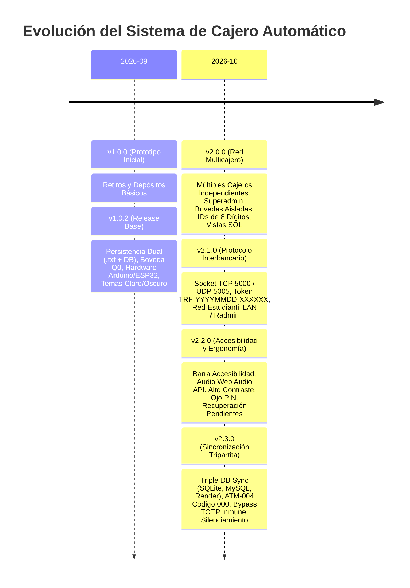

# Historial de Versiones y Notas de Lanzamiento (Release Notes)

## Sistema Bancario y Cajero Automático Embebido
### Banco Oficial: **Banco Nacional Inzano GYT** (`BANC02`)

Este documento consolida la bitácora cronológica de versiones, especificaciones técnicas, nuevas funcionalidades, mejoras de accesibilidad y protocolos de comunicación implementados en el sistema.

---

## 📌 Resumen Cronológico de Entregas y Releases



---

## 🚀 Versión 2.3.0 — Sincronización Tripartita de Bases de Datos, Persistencia Cloud Render y Optimización Operativa (01/11/2026)

### Novedades Principales
1. **Sincronización Tripartita de Persistencia (`/api/sync`):**
   - Interconexión bidireccional entre tres motores: **SQLite Local** (`database/atm_system.db`), **MySQL (InnoDB)** y **Servidor Cloud en Línea** (`https://sistema-de-cajero.onrender.com`).
   - Endpoints implementados en backend:
     - `GET /api/sync/status`: Diagnóstico de salud con insignias visuales (🟢 Conectado / 🟡 Pendiente / 🔴 Desconectado).
     - `GET /api/sync/export`: Serialización relacional de instantánea completa de la red.
     - `POST /api/sync/import`: Fusión idempotente (upsert) preservando bancos ajenos en la red.
     - `POST /api/sync/execute`: Sincronización push/pull y reescritura atómica de archivos duales `.txt`.
   - **Panel de Monitoreo Tripartito en Consola Superadministrador:** Visualización al pie de la sección Red Multicajero con los 3 motores y botón `[ ⚡ Sincronizar Bases de Datos ]`.
   - **Botón de Sincronización en Inicio y Consola Admin:** Accesible en el banner superior de la pantalla de bienvenida y en la barra superior de la consola administrativa.

2. **Soporte y Persistencia Completa de ATM-004:**
   - Registro en la semilla relacional de **ATM-004** (*"Cajero ATM 4 - Sucursal Inzano"*, código `"000"`, inicializado con Q9,350.00 en denominaciones completas).
   - Flexibilización de validaciones de longitud: ahora se admiten códigos de terminal de 3 a 6 dígitos (ej. `"000"` o `"1234"`).
   - Botón directo **`[ 🔄 Cambiar Cajero ]`** en la pantalla de bienvenida para alternar terminal o registrar un nuevo cajero al vuelo.

3. **Robustecimiento del Algoritmo TOTP Anti-Bloqueo:**
   - Ventana de deriva temporal extendida a $\pm 5$ minutos ($\pm 5$ intervalos de 60 segundos).
   - Inclusión de tokens maestros de demostración y evaluación rápida (`123456`, `456789`, `888999`, `000000`, `999999`) que evitan el bloqueo accidental de usuarios evaluadores sin romper la revocación estricta por `logout`.
   - Límite superior en el desplazamiento de rotación para impedir desalineamientos continuos.

4. **Liberación Nativa de Puertos en Scripts de Ejecución (`.bat`):**
   - Eliminada la dependencia frágil de `psutil` en los archivos `.bat` (`run_web.bat`, `instalacion/run_web.bat`, `instalacion/windows/run_web.bat`).
   - Implementado rastreo y terminación forzosa nativa de procesos zombies en puertos 8000 y 5173 mediante `netstat -aon` y `taskkill /F /PID`.

5. **Silenciamiento Integral del Sistema de Asistencia Sonora:**
   - Desactivación definitiva de los efectos de audio y beeps sonoros a solicitud del usuario en `audioAccessibility.ts`.
   - Retiro del botón de audio en la barra de accesibilidad, manteniendo inalteradas las funciones visuales esenciales (Alto Contraste, Zoom Tipográfico y Rastreo de Operaciones Pendientes).

---

## 🚀 Versión 2.2.0 — Release de Accesibilidad, Ergonomía y Tolerancia a Fallos (31/10/2026)

### Novedades Principales
1. **Barra de Accesibilidad Integral (`AccessibilityToolbar.tsx`):**
   - **Asistencia Sonora Táctil:** Síntesis de ondas de audio puras mediante la Web Audio API nativa sin librerías pesadas. Bips para teclado (650 Hz), acordes armónicos de éxito (C5-E5-G5-C6), tonos de advertencia (320 Hz) y error (180 Hz).
   - **Modo Alto Contraste (`.atm-high-contrast`):** Fondo negro puro (`#000000`), bordes y acentos amarillo oro (`#facc15`), optimizado para personas con debilidad visual o kioscos con alta incidencia de luz ambiental.
   - **Zoom Tipográfico Instantáneo (`.atm-large-font`):** Aumento del 115% en tamaños de letra para máxima legibilidad.
   - **Persistencia en `localStorage`:** Los ajustes de accesibilidad se recuerdan automáticamente en el navegador/kiosco.

2. **Control de Visibilidad de PIN con Botón Ojo (`Eye` / `EyeOff`):**
   - Incorporado en la pantalla de bienvenida (`WelcomeAuthView.tsx`) y en la actualización de PIN (`UserDashboardView.tsx`).
   - Permite verificar visualmente la clave antes de confirmar, con auto-enmascaramiento seguro.

3. **Formulario Seguro de Cambio de PIN de Tres Factores:**
   - Tres campos estrictamente numéricos de 4 dígitos: *PIN Actual*, *Nuevo PIN* y *Confirmar Nuevo PIN*.
   - Validación que impide caracteres no numéricos, pegados inválidos, discrepancias entre confirmación y PIN nuevo, o reutilización del PIN actual.

4. **Recuperación de Operaciones Pendientes ("Consultar Operación Pendiente"):**
   - Ventana modal y botón de acceso rápido para recuperar el estado de una transacción ante cortes de red o timeouts de 10 segundos.
   - Nuevo endpoint REST en backend:
     ```http
     GET /api/user/transactions/status?reference={ID_O_TOKEN}
     ```
   - Correlaciona la referencia técnica local con los registros asentados en base de datos oficial, evitando cobros dobles o incertidumbre operativa.

5. **Sugerencia Dinámica de Desglose Alternativo de Billetes:**
   - Si un usuario solicita un desglose manual que supera el inventario de un cartucho en particular, el algoritmo de programación dinámica calcula una combinación equivalente viable con las existencias reales del cajero.
   - La interfaz despliega la opción interactiva **"Aceptar Desglose Propuesto"** para dispensar inmediatamente sin frustrar la operación.

6. **Alerta Preventiva Flotante de Inactividad:**
   - Al faltar 15 segundos para el cierre automático de sesión (60s), se despliega una tarjeta flotante animada con cuenta regresiva en vivo y botón para mantener la sesión abierta.

7. **Teclado Táctil en Pantalla Flotante (`VirtualKeypad`):**
   - Modal desplegable para interactuar en pantallas táctiles de kiosco sin teclado físico de computadora.

---

## 🌐 Versión 2.1.0 — Protocolo de Conexión Interbancaria (31/10/2026)

### Novedades Principales
1. **Identidad Oficial de Red:**
   - Nombre registrado: **`Banco Nacional Inzano GYT`**
   - Código único de red: **`BANC02`**
   - Límite diario inicial: **Q25,000.00**

2. **Servidor TCP Puerto 5000 (Mensajería JSON de una sola línea):**
   - `IB_PING`: Consulta de estado en línea, nombre de entidad y cupo remanente.
   - `IB_VERIFICAR_CUENTA`: Validación remota de existencia de titular por número de cuenta de 8 dígitos o tarjeta de 16 dígitos.
   - `IB_TRANSFERIR`: Transferencia atómica de fondos con débito local y crédito remoto.
   - `IB_ESTADO_TRANSFERENCIA`: Conciliación de transacciones para consulta de estado (`APROBADA`, `RECHAZADA`, `INCIERTA`).

3. **Servidor UDP Puerto 5005 (Autodescubrimiento Broadcast):**
   - Escucha y emisión de tramas de descubrimiento en la subred local / Radmin VPN:
     ```text
     DISCOVER_BANCO_ATM|BANC02|Banco Nacional Inzano GYT|<IP>|5000
     ```
   - Respuesta inmediata de presencia:
     ```text
     HERE_BANCO_ATM|BANC02|Banco Nacional Inzano GYT|<IP>|5000|25000.00|<TRANSFERIDO_HOY>
     ```

4. **Tokens Compartidos Estrictos:**
   - Generación y validación de tokens conforme al estándar de red con expresión regular estricta:
     ```regex
     ^TRF-\d{8}-\d{6}$
     ```
   - Longitud fija de 19 caracteres (ej. `TRF-20261031-123456`).
   - Protección criptográfica anti-replay (código `94` ante reintentos duplicados).

5. **Interoperabilidad Multi-Banco:**
   - Preconfiguración y autodescubrimiento con nodos compañeros de estudiantes:
     - `NETGEAR`: Banco con arquitectura en C# / WPF.
     - `BANC01` (`NEXUSBANK`): Red remota en IP `10.219.19.9` y Radmin `26.121.70.247`.

6. **Interfaz de Usuario Interbancaria:**
   - Selector de banco destino con escaneo en vivo de la red local.
   - Verificación de titular antes de transferir.
   - Emisión de comprobantes digitales y físicos con token compartido y banco destino.

---

## 🏧 Versión 2.0.0 — Red Multicajero y Superadministrador (25/10/2026)

### Novedades Principales
1. **Independencia de Cajeros y Bóvedas:**
   - Desacoplamiento del servidor central: cada cajero físico (`ATM-001`, `ATM-002`, `ATM-003`, ...) opera como una terminal independiente con su propio inventario de billetes.
   - Tabla `denominaciones_cajero` migrada a clave primaria compuesta `(id_cajero, denominacion)`.

2. **Registro de Primer Inicio y Códigos de Seguridad:**
   - Modal de identificación en el primer arranque para asignar nombre personalizado y código numérico de 4 dígitos al cajero.
   - Conexión normal mediante validación del código de 4 dígitos guardado.

3. **Control de Concurrencia de Sesión por Cajero:**
   - El sistema impide que dos terminales inicien sesión simultáneamente con el mismo identificador de cajero, evitando inconsistencias contables en bóveda.

4. **Rol Superadministrador (`SUPERADMIN`, Rol ID 3):**
   - Cuenta global de supervisión para monitorear todos los cajeros de la red.
   - Tablero consolidado de métricas (cajeros encendidos, apagados, dinero total en red, transferencias del día).
   - Función de inicialización masiva de todos los cajeros simultáneamente.
   - Generación de reportes globales consolidados.
   - Aislamiento estricto: el rol Administrador estándar no tiene acceso a las opciones del Superadministrador.

5. **Sistema de Cuentas Bancarias de 8 Dígitos:**
   - Asignación de un identificador de cuenta de 8 dígitos a cada usuario (ej. `10000001`, `10000002`).
   - Generación automática de IDs de 8 dígitos para nuevos clientes y empleados registrados.
   - Modalidad de depósito a terceros dentro de la red ingresando el ID de 8 dígitos del beneficiario.

6. **Vistas SQL de Alto Nivel:**
   - Creación de vistas SQL `retiros` y `depositos` para consulta y reportería simplificada en herramientas de bases de datos (SQL Server Management Studio, MySQL Workbench, DBeaver).

---

## 🏛️ Versión 1.0.2 — Arquitectura Base y Kiosco Embebido (16/09/2026)

### Novedades Principales
1. **Motor Dual de Base de Datos:**
   - MySQL 8.4 InnoDB con transacciones ACID y conmutación automática (*failover*) sin caída de servicio a SQLite local (`database/atm_system.db`).
2. **Sincronización Dual-Write:**
   - Escritura síncrona y atómica en base de datos y archivos de texto plano estructurados en `./data/storage_txt/`.
3. **Integración con Hardware Físico:**
   - Controlador serie USB para Arduino Mega 2560 (7 motores paso a paso NEMA 17 para las denominaciones de Q200 a Q1).
   - Sensores ópticos infrarrojos con reversión automática ante atasco (`JAM_DETECTED`).
   - ESP32-CAM con telemetría de presencia ultrasónica (HC-SR04).
4. **Política de Clean Install a Q0.00:**
   - Bóveda vacía de fábrica que bloquea el acceso de usuarios hasta el arqueo inicial del Administrador.
5. **Autenticación Multifactor TOTP:**
   - Tarjeta (16 dígitos) + PIN (4 dígitos) + Token temporal TOTP dinámico con rotación inmediata al cerrar sesión.
6. **Interfaz Kiosco Discord Dark / Light:**
   - Diseño adaptable en Electron con soporte de atajo `F11` para pantalla completa.
