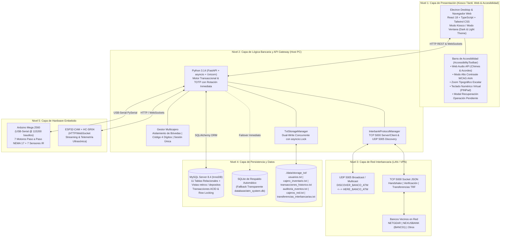
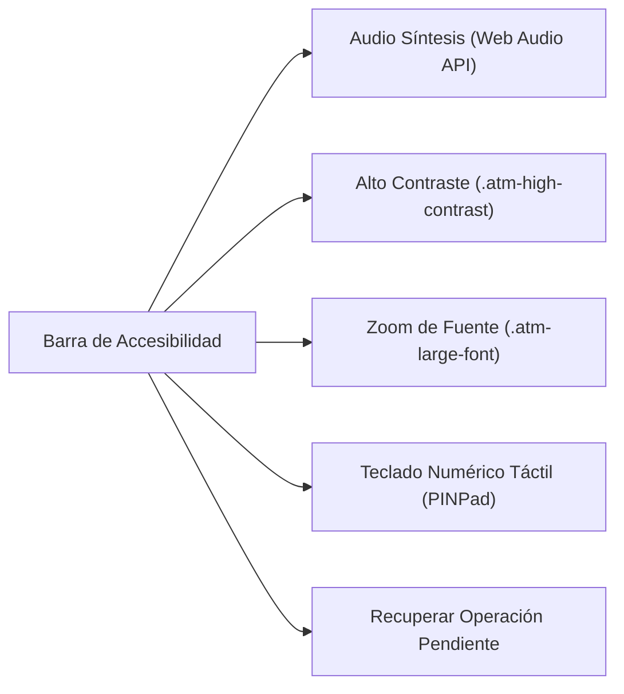

# Manual Técnico de Arquitectura y Hardware Embebido

## Sistema Bancario y Cajero Automático Embebido (ATM Kiosk) - Versión 2.2.0
### Red Multicajero, Protocolo Interbancario TCP 5000 / UDP 5005 y Accesibilidad Integral

---

### Registro Cronológico de Versiones

Para el detalle exhaustivo de cambios, commits e incidencias resueltas, consulte [HISTORIAL_RELEASES.md](file:///c:/Users/majop/Documents/Sistema-De-Cajero-main/docs/HISTORIAL_RELEASES.md).

* **Versión 1.0.2 (Base):** Persistencia relacional MySQL 8.4 InnoDB con failover automático e instantáneo a SQLite local (`database/atm_system.db`), sincronización paralela en archivos de texto plano (`Dual-Write`), política de bóveda limpia a Q0.00 (`Clean Install`), hardware embebido Arduino Mega 2560 (7 motores paso a paso NEMA 17 y 7 sensores infrarrojos) + ESP32-CAM con telemetría ultrasónica HC-SR04, y motor de temas claro/oscuro WCAG AAA.
* **Versión 2.0.0 (Red Multicajero & Superadministrador):** Desacoplamiento de cajeros independientes (`ATM-001`, `ATM-002`, `ATM-003`, escalable), aislamiento de bóvedas físicas individuales en `denominaciones_cajero(id_cajero, denominacion)`, registro de primer inicio con código de seguridad de 4 dígitos, candado de concurrencia de sesión única activa (`sesion_activa_id`), rol Superadministrador (`SUPERADMIN`) con dashboard consolidado y encendido/inicialización en lote, IDs de cuenta bancaria de 8 dígitos (`id_cuenta_bancaria`), depósitos a terceros intra-banco y vistas SQL `retiros` y `depositos`.
* **Versión 2.1.0 (Protocolo Interbancario TCP 5000 / UDP 5005):** Comunicación peer-to-peer interbancaria sobre LAN / Radmin VPN. Autodescubrimiento UDP 5005 (`DISCOVER_BANCO_ATM` / `HERE_BANCO_ATM`), servidor y cliente TCP 5000 con transacciones JSON atómicas (`IB_PING`, `IB_VERIFICAR_CUENTA`, `IB_TRANSFERIR`, `IB_ESTADO_TRANSFERENCIA`), validación estricta de tokens `^TRF-\d{8}-\d{6}$`, protección anti-repetición (*replay attacks*, código `94`), control de cupo diario interbancario coordinado (código `65`), e identidad oficial **`Banco Nacional Inzano GYT`** (`BANC02`) interoperable con `NETGEAR` y `BANC01` (`NEXUSBANK`).
* **Versión 2.2.0 (Accesibilidad, Ergonomía y Tolerancia a Fallos - Actual):** Barra de Accesibilidad flotante (`AccessibilityToolbar.tsx`) con sintetizador sonoro Web Audio API (chimes para clic, éxito en acorde C5-E5-G5-C6, advertencia y error), Modo Alto Contraste accesible (`.atm-high-contrast`), Zoom tipográfico (`.atm-large-font`), teclado numérico táctil en pantalla (PINPad flotante), alternador de visibilidad de PIN con icono de ojo (`Eye`/`EyeOff`), formulario de cambio de PIN con triple validación (Actual, Nuevo y Confirmación), recuperación de operaciones interrumpidas ("Consultar Operación Pendiente" con endpoint `/api/user/transactions/status`), propuesta inteligente de desglose alternativo ante inventario insuficiente en bóveda y alerta modal de inactividad a los 15 segundos restantes.

---

### 1. Arquitectura General del Sistema

El sistema opera bajo un modelo de arquitectura desacoplada en cinco niveles:



---

### 2. Especificación de Hardware Embebido

#### 2.1 Arduino Mega 2560 (Controlador de Dispensación de Efectivo)
* **Bus de Comunicación:** USB-Serial a 115200 baudios, 8 bits de datos, sin paridad, 1 bit de parada (8N1).
* **Controladores de Motor:** Siete (7) módulos Allegro A4988 configurados a 1/16 de micropaso, conectados a motores bipolares paso a paso NEMA 17:
  * Cartucho Q200: Pin STEP 22, Pin DIR 23
  * Cartucho Q100: Pin STEP 24, Pin DIR 25
  * Cartucho Q50:  Pin STEP 26, Pin DIR 27
  * Cartucho Q20:  Pin STEP 28, Pin DIR 29
  * Cartucho Q10:  Pin STEP 30, Pin DIR 31
  * Cartucho Q5:   Pin STEP 32, Pin DIR 33
  * Cartucho Q1:   Pin STEP 34, Pin DIR 35
  * Pin de Habilitación Común (`ENABLE`): Pin 38
* **Sensores Ópticos Infrarrojos de Ranura (IR):**
  * Detectan el borde anterior y posterior del billete para conteo físico preciso.
  * Pines de interrupción de hardware y muestreo digital: 2, 3, 18, 19, 20, 21, 4.
* **Trama JSON de Salida hacia Arduino:**
  ```json
  {"cmd": "DISPENSE", "bills": {"200": 0, "100": 1, "50": 0, "20": 1, "10": 0, "5": 0, "1": 3}}
  ```
* **Respuesta de Confirmación Exitosa:**
  ```json
  {"status": "SUCCESS", "dispensed": 123}
  ```
* **Respuesta ante Falla Mecánica u Obstrucción Óptica:**
  ```json
  {"status": "ERROR", "code": "JAM_DETECTED", "dispensed": 0}
  ```
  *Regla de Seguridad Bancaria:* Si el microcontrolador detecta atasco (`JAM_DETECTED`), el motor transaccional de FastAPI revierte automáticamente el débito en la cuenta del usuario, restaura los saldos contables y emite un log de auditoría clasificado como evento crítico.

#### 2.2 ESP32-CAM (Cámara de Seguridad y Detección de Presencia)
* **Sensor de Imagen Omnivision OV2640:** Captura tomas en resolución VGA (640x480 JPEG) en cada confirmación de retiro o depósito para respaldo forense.
* **Sensor Ultrasónico HC-SR04:**
  * Pin Trigger: GPIO 13 | Pin Echo: GPIO 12.
  * Muestreo continuo a 10 Hz; si la distancia es $\le 100\text{ cm}$, se clasifica `user_present: true`.
  * La telemetría se transmite al frontend mediante WebSocket (`/api/ws/telemetry`).

---

### 3. Modelo de Datos Relacional Completo (MySQL 8.4 InnoDB)

El esquema relacional cuenta con 11 tablas transaccionales y 2 vistas optimizadas, garantizando integridad referencial, transacciones ACID y aislamiento multi-cajero:

```sql
DROP DATABASE IF EXISTS atm_system;
CREATE DATABASE atm_system CHARACTER SET utf8mb4 COLLATE utf8mb4_unicode_ci;
USE atm_system;

-- 1. Control de Acceso Basado en Roles (RBAC)
CREATE TABLE roles (
    id_rol INT AUTO_INCREMENT PRIMARY KEY,
    nombre_rol VARCHAR(50) NOT NULL UNIQUE
) ENGINE=InnoDB;

INSERT INTO roles (id_rol, nombre_rol) VALUES 
(1, 'ADMINISTRADOR'), (2, 'USUARIO'), (3, 'SUPERADMIN');

-- 2. Cuentas de Usuario Corporativo
CREATE TABLE usuarios (
    id_usuario INT AUTO_INCREMENT PRIMARY KEY,
    id_rol INT NOT NULL,
    nombre_completo VARCHAR(100) NOT NULL,
    id_cuenta_bancaria VARCHAR(20) UNIQUE NULL,
    pin_hash VARCHAR(255) NOT NULL,
    token_temporal VARCHAR(10) NULL,
    saldo_actual DECIMAL(12,2) NOT NULL DEFAULT 0.00,
    monto_max_diario DECIMAL(12,2) NOT NULL DEFAULT 2000.00,
    total_retirado_hoy DECIMAL(12,2) NOT NULL DEFAULT 0.00,
    cambio_pin_realizado BOOLEAN NOT NULL DEFAULT FALSE,
    fecha_ultimo_acceso DATETIME NULL,
    activo BOOLEAN NOT NULL DEFAULT TRUE,
    is_deleted BOOLEAN NOT NULL DEFAULT FALSE,
    deleted_at DATETIME NULL,
    deleted_by_id INT NULL,
    FOREIGN KEY (id_rol) REFERENCES roles(id_rol) ON UPDATE CASCADE
) ENGINE=InnoDB;

-- 3. Tarjetas Plásticas de Débito (16 Dígitos)
CREATE TABLE tarjetas (
    id_tarjeta INT AUTO_INCREMENT PRIMARY KEY,
    id_usuario INT NOT NULL,
    numero_tarjeta VARCHAR(16) NOT NULL UNIQUE,
    activa BOOLEAN NOT NULL DEFAULT TRUE,
    fecha_asignacion DATETIME NOT NULL DEFAULT CURRENT_TIMESTAMP,
    is_deleted BOOLEAN NOT NULL DEFAULT FALSE,
    deleted_at DATETIME NULL,
    FOREIGN KEY (id_usuario) REFERENCES usuarios(id_usuario) ON UPDATE CASCADE
) ENGINE=InnoDB;

-- 4. Red de Cajeros Automáticos (Instancias Independientes)
CREATE TABLE cajeros (
    id_cajero VARCHAR(20) PRIMARY KEY,
    nombre VARCHAR(100) NOT NULL,
    ubicacion VARCHAR(150) NULL,
    estado VARCHAR(20) NOT NULL DEFAULT 'ACTIVO',
    is_initialized BOOLEAN NOT NULL DEFAULT FALSE,
    codigo_cajero VARCHAR(10) NOT NULL DEFAULT '1234',
    en_linea BOOLEAN NOT NULL DEFAULT FALSE,
    sesion_activa_id VARCHAR(100) NULL,
    ultimo_latido DATETIME NULL,
    fecha_creacion DATETIME NOT NULL DEFAULT CURRENT_TIMESTAMP
) ENGINE=InnoDB;

-- 5. Inventario Físico de Bóveda por Cajero
CREATE TABLE denominaciones_cajero (
    id_denominacion INT AUTO_INCREMENT PRIMARY KEY,
    id_cajero VARCHAR(20) NOT NULL DEFAULT 'ATM-001',
    denominacion INT NOT NULL,
    cantidad_billetes INT NOT NULL DEFAULT 0,
    CONSTRAINT chk_denominacion CHECK (denominacion IN (200, 100, 50, 20, 10, 5, 1)),
    UNIQUE KEY uq_cajero_denom (id_cajero, denominacion),
    FOREIGN KEY (id_cajero) REFERENCES cajeros(id_cajero) ON UPDATE CASCADE
) ENGINE=InnoDB;

-- 6. Arqueos e Inicializaciones de Bóveda
CREATE TABLE arqueos_cajero (
    id_arqueo INT AUTO_INCREMENT PRIMARY KEY,
    id_cajero VARCHAR(20) NOT NULL DEFAULT 'ATM-001',
    tipo_evento VARCHAR(20) NOT NULL, -- INICIALIZACION | RECARGA | RESET
    monto_total DECIMAL(12,2) NOT NULL,
    fecha_evento DATETIME NOT NULL DEFAULT CURRENT_TIMESTAMP,
    FOREIGN KEY (id_cajero) REFERENCES cajeros(id_cajero) ON UPDATE CASCADE
) ENGINE=InnoDB;

-- 7. Histórico Financiero y Transacciones
CREATE TABLE transacciones (
    id_transaccion INT AUTO_INCREMENT PRIMARY KEY,
    id_cajero VARCHAR(20) DEFAULT 'ATM-001',
    id_usuario INT NOT NULL,
    tipo_transaccion VARCHAR(30) NOT NULL, -- RETIRO | DEPOSITO | DEPOSITO_A_TERCERO | TRANSFERENCIA_INTERBANCARIA
    monto DECIMAL(12,2) NOT NULL,
    fecha_hora DATETIME NOT NULL DEFAULT CURRENT_TIMESTAMP,
    desglose_billetes JSON NOT NULL,
    id_cuenta_destino VARCHAR(20) NULL,
    nombre_destinatario VARCHAR(100) NULL,
    token_transferencia VARCHAR(40) NULL,
    FOREIGN KEY (id_usuario) REFERENCES usuarios(id_usuario) ON UPDATE CASCADE,
    FOREIGN KEY (id_cajero) REFERENCES cajeros(id_cajero) ON UPDATE CASCADE
) ENGINE=InnoDB;

-- 8. Pista de Auditoría de Seguridad
CREATE TABLE logs_auditoria (
    id_log INT AUTO_INCREMENT PRIMARY KEY,
    id_cajero VARCHAR(20) NULL,
    id_usuario INT NULL,
    accion VARCHAR(100) NOT NULL,
    detalles TEXT NULL,
    fecha_hora DATETIME NOT NULL DEFAULT CURRENT_TIMESTAMP
) ENGINE=InnoDB;

-- 9. Respaldo Forense de Bajas Lógicas (Soft-Delete)
CREATE TABLE registros_eliminados (
    id_eliminacion INT AUTO_INCREMENT PRIMARY KEY,
    tabla_origen VARCHAR(50) NOT NULL,
    id_registro_origen INT NOT NULL,
    datos_eliminados_json JSON NOT NULL,
    motivo VARCHAR(255) NULL,
    eliminado_por_id INT NULL,
    eliminado_por_nombre VARCHAR(100) NULL,
    id_usuario_afectado INT NULL,
    visible_para_usuario BOOLEAN NOT NULL DEFAULT TRUE,
    fecha_eliminacion DATETIME NOT NULL DEFAULT CURRENT_TIMESTAMP
) ENGINE=InnoDB;

-- 10. Catálogo de Bancos Conectados en Red (TCP/UDP)
CREATE TABLE bancos_red (
    id_banco INT AUTO_INCREMENT PRIMARY KEY,
    codigo_banco VARCHAR(15) NOT NULL UNIQUE,
    nombre_banco VARCHAR(100) NOT NULL,
    ip VARCHAR(50) NOT NULL DEFAULT '127.0.0.1',
    puerto INT NOT NULL DEFAULT 5000,
    es_propio BOOLEAN NOT NULL DEFAULT FALSE,
    limite_diario DECIMAL(12,2) NOT NULL DEFAULT 25000.00,
    transferido_hoy DECIMAL(12,2) NOT NULL DEFAULT 0.00,
    fecha_ultimo_reinicio DATETIME NOT NULL DEFAULT CURRENT_TIMESTAMP,
    activo BOOLEAN NOT NULL DEFAULT TRUE
) ENGINE=InnoDB;

-- 11. Registro de Transferencias Interbancarias y Conciliación
CREATE TABLE transferencias_bancarias (
    id_transferencia INT AUTO_INCREMENT PRIMARY KEY,
    token_transferencia VARCHAR(40) NOT NULL,
    tipo_transferencia VARCHAR(20) NOT NULL DEFAULT 'INTERBANCARIA',
    banco_origen VARCHAR(15) NOT NULL,
    cuenta_origen VARCHAR(20) NOT NULL,
    nombre_origen VARCHAR(100) NOT NULL,
    banco_destino VARCHAR(15) NOT NULL,
    cuenta_destino VARCHAR(20) NOT NULL,
    nombre_destino VARCHAR(100) NOT NULL,
    monto DECIMAL(12,2) NOT NULL,
    concepto VARCHAR(200) NULL,
    cupo_restante_banco_origen DECIMAL(12,2) NULL,
    cupo_restante_banco_destino DECIMAL(12,2) NULL,
    estado VARCHAR(20) NOT NULL DEFAULT 'APROBADA',
    fecha_creacion DATETIME NOT NULL DEFAULT CURRENT_TIMESTAMP,
    INDEX idx_token_transferencia (token_transferencia)
) ENGINE=InnoDB;

-- Vistas Especializadas para SQL Management Studio / Consola
CREATE OR REPLACE VIEW retiros AS
SELECT 
    t.id_transaccion,
    t.id_cajero,
    t.id_usuario,
    u.nombre_completo AS cliente,
    t.monto,
    t.fecha_hora,
    t.desglose_billetes
FROM transacciones t
JOIN usuarios u ON t.id_usuario = u.id_usuario
WHERE t.tipo_transaccion = 'RETIRO';

CREATE OR REPLACE VIEW depositos AS
SELECT 
    t.id_transaccion,
    t.id_cajero,
    t.id_usuario,
    u.nombre_completo AS cliente,
    t.monto,
    t.tipo_transaccion,
    t.id_cuenta_destino,
    t.nombre_destinatario,
    t.token_transferencia,
    t.fecha_hora,
    t.desglose_billetes
FROM transacciones t
JOIN usuarios u ON t.id_usuario = u.id_usuario
WHERE t.tipo_transaccion IN ('DEPOSITO', 'DEPOSITO_A_TERCERO', 'TRANSFERENCIA_INTERBANCARIA');
```

---

### 4. Protocolo de Conexión Interbancaria (TCP 5000 / UDP 5005)

El sistema integra un subsistema de comunicaciones distribuido compatible con el estándar de interconexión bancaria universitaria local:

#### 4.1 Identidad Bancaria Oficial
* **Código de Banco:** `BANC02`
* **Nombre Oficial:** `Banco Nacional Inzano GYT`
* **Puerto TCP de Operaciones:** `5000`
* **Puerto UDP de Descubrimiento:** `5005`
* **Tope Diario de Interconexión:** `Q25,000.00` (con reinicio automático diario en UTC).

#### 4.2 Autodescubrimiento UDP (Puerto 5005)
1. **Emisión de Descubrimiento:** Cuando un cajero inicia o solicita refrescar la lista de bancos, envía un paquete UDP en Broadcast (`255.255.255.255` o `192.168.x.255`) al puerto 5005:
   ```json
   {
     "tipo": "DISCOVER_BANCO_ATM",
     "codigoBanco": "BANC02",
     "nombreBanco": "Banco Nacional Inzano GYT",
     "puerto": 5000,
     "timestamp": "2026-10-31 21:00:00"
   }
   ```
2. **Respuesta Unicast (`HERE_BANCO_ATM`):** Cada banco receptor que escuche el mensaje responde directamente a la IP del solicitante:
   ```json
   {
     "tipo": "HERE_BANCO_ATM",
     "codigoBanco": "BANC01",
     "nombreBanco": "NEXUSBANK",
     "ip": "10.219.19.9",
     "puerto": 5000,
     "limiteDiario": 25000.00,
     "cupoDisponible": 21500.00
   }
   ```
3. El módulo registra y actualiza dinámicamente la tabla `bancos_red`.

#### 4.3 Mensajería TCP (Puerto 5000)
Toda comunicación TCP se realiza mediante tramas JSON delimitadas por salto de línea (`\n`), con límite estricto de timeout de 5 segundos y tamaño máximo de 64 KB para evitar ataques de denegación de servicio:

1. **`IB_PING` (Latido / Conectividad):**
   * Solicitud: `{"tipo": "IB_PING", "bancoOrigen": "BANC02", "idMensaje": "MSG-1001"}`
   * Respuesta: `{"tipo": "RESP_PONG", "codigo": "00", "banco": "BANC01", "mensaje": "En linea", "cupoDisponible": 25000.0}`
2. **`IB_VERIFICAR_CUENTA` (Consulta Previa de Destinatario):**
   * Solicitud: `{"tipo": "IB_VERIFICAR_CUENTA", "bancoDestino": "BANC02", "cuentaDestino": "10014528"}`
   * Respuesta: `{"tipo": "RESP_VERIFICAR_CUENTA", "codigo": "00", "existe": true, "titular": "Carlos Roberto Gómez"}`
3. **`IB_TRANSFERIR` (Ejecución Atómica de Fondos):**
   * Solicitud:
     ```json
     {
       "tipo": "IB_TRANSFERIR",
       "token": "TRF-20261031-153022",
       "bancoOrigen": "NETGEAR",
       "bancoDestino": "BANC02",
       "cuentaOrigen": "99998888",
       "nombreOrigen": "Juan Remitente",
       "cuentaDestino": "10014528",
       "nombreDestino": "Carlos Roberto Gómez",
       "monto": 150.00,
       "concepto": "Pago de servicios"
     }
     ```
   * Respuesta: `{"tipo": "RESP_TRANSFERIR", "codigo": "00", "token": "TRF-20261031-153022", "mensaje": "Transferencia exitosa", "cupoRestante": 24850.00}`
4. **`IB_ESTADO_TRANSFERENCIA` (Consulta y Conciliación):**
   * Solicitud: `{"tipo": "IB_ESTADO_TRANSFERENCIA", "token": "TRF-20261031-153022"}`
   * Respuesta: `{"tipo": "RESP_ESTADO_TRANSFERENCIA", "codigo": "00", "estado": "APROBADA", "monto": 150.00}`

#### 4.4 Códigos de Respuesta Bancaria ISO/Estándar
* **`00`:** Transacción Aprobada / Éxito.
* **`12`:** Formato inválido o excede límite de tamaño (64 KB).
* **`14`:** Cuenta no encontrada o inactiva en el banco destino.
* **`51`:** Fondos insuficientes en la cuenta de origen.
* **`65`:** Excede límite diario interbancario acumulado (Q25,000.00).
* **`91`:** Banco emisor o receptor temporalmente inaccesible.
* **`94`:** Transacción duplicada / Detección de repetición (*Replay Attack* con token previamente procesado).
* **`96`:** Error interno del sistema o JSON malformado.

---

### 5. Arquitectura de Red Multicajero y Consola Superadministrador

#### 5.1 Desacoplamiento de Bóvedas y Cajeros
* Cada cajero físico o terminal web (`ATM-001`, `ATM-002`, `ATM-003`, etc.) opera con inventario independiente en la tabla `denominaciones_cajero` indexado por `id_cajero`.
* Los retiros y depósitos en un cajero debitan e incrementan exclusivamente las piezas físicas de ese cajero.
* El saldo contable del usuario es global en la tabla `usuarios` y accesible desde cualquier ATM de la red.

#### 5.2 Registro de Primer Inicio y Concurrencia
* Al arrancar un cajero nuevo, se solicita el **Nombre del Cajero** y se le asigna un **Código de Seguridad de 4 Dígitos** que se persiste en la columna `codigo_cajero`.
* Para inicios subsiguientes, el cajero solicita su código para desbloquear la sesión operativa.
* **Candado de Sesión Única Activa:** Cuando una terminal inicia sesión como `ATM-001`, se genera un identificador UUID en `sesion_activa_id`. Si otra ventana o dispositivo intenta ingresar simultáneamente como `ATM-001`, el backend deniega el acceso (`409 Conflict`) hasta que la sesión previa expire o sea cerrada formalmente.

#### 5.3 Rol Superadministrador (`SUPERADMIN`)
* Identificado por `id_rol = 3` con acceso exclusivo (el usuario Administrador regular no tiene visibilidad ni acceso a este módulo).
* Credenciales de acceso de prueba: Tarjeta `8888-8888-8888-8888`, PIN `1234`, Token dinámico `888999`.
* Capacidades de Consola Global:
  * Tablero consolidado en tiempo real con estado de cada cajero (En Línea / Apagado, Saldo de Bóveda individual, Último latido).
  * Función de "Inicialización en Lote" para cargar y aperturar todos los cajeros de la red simultáneamente.
  * Auditoría cruzada con desglose de transacciones y retiros efectuados en toda la institución.

---

### 6. Subsistema de Accesibilidad y Ergonomía (v2.2.0)

La interfaz integra el componente `AccessibilityToolbar.tsx` diseñado bajo lineamientos WCAG 2.1 AA/AAA:



1. **Retroalimentación Auditiva Asistida (Web Audio API):**
   * Generación de tonos sinusoidales puros sin librerías externas:
     * **Clic / Interacción:** Tono de 650 Hz (duración 40 ms).
     * **Éxito Transaccional:** Acorde arpegiado C5 (523 Hz), E5 (659 Hz), G5 (784 Hz), C6 (1046 Hz).
     * **Advertencia / Inactividad:** Tono de 320 Hz (duración 120 ms).
     * **Error / Rechazo:** Tono grave de 180 Hz (duración 200 ms).
2. **Modo Alto Contraste:** Aplica clase raíz con fondo negro absoluto (`#000000`), bordes y acentos amarillo reflectivo (`#FFD700`) y tipografía blanca de máxima luminancia.
3. **Escalamiento Tipográfico:** Multiplicador global de tamaño de fuente (+25%) para usuarios con debilidad visual.
4. **Teclado Numérico Virtual Flotante (PINPad):** Proporciona un teclado táctil reubicable en pantalla para usuarios con movilidad reducida o interfaces táctiles sin teclado físico.
5. **Recuperación de Operaciones Caídas:** Modal que permite al usuario o cajero ingresar un token o número de referencia para consultar el endpoint `GET /api/user/transactions/status?reference=...`. Si un fallo de red o corte eléctrico ocurre tras debitar la cuenta, este mecanismo reconcilia la transacción sin duplicar cargos.
6. **Propuesta de Desglose Alternativo:** Si el cliente solicita un retiro y el algoritmo greedy/dinámico determina que el cajero no cuenta con los billetes exactos seleccionados pero sí con el importe total, el sistema calcula una combinación viable y le ofrece el botón *"Aceptar Desglose Propuesto"*.
7. **Formulario Seguro de Cambio de PIN:** Valida PIN actual, Nuevo PIN y Confirmación de Nuevo PIN para evitar errores de mecanografía irreversibles.
8. **Alerta de Inactividad Temprana:** Temporizador de 60 segundos con advertencia modal acústica y visual a los 15 segundos antes del cierre de sesión automático.

---

### 7. Persistencia Dual Concurrente en Archivos Planos (.txt)

Toda mutación en base de datos ejecuta una réplica paralela en `./data/storage_txt/`:
* **`usuarios.txt`:** `ID_USUARIO|NOMBRE_COMPLETO|TARJETA_ACTUAL|PIN_HASH|SALDO_ACTUAL|MONTO_MAX_DIARIO|TOTAL_RETIRADO_HOY|CAMBIO_PIN|ULTIMO_ACCESO`
* **`cajero_inventario.txt`:** Inventario de piezas físicas por denominación y total en bóveda.
* **`cajeros_red.txt`:** Lista de cajeros de la institución, ubicaciones y códigos de inicio.
* **`transacciones_historico.txt`:** Registro inmutable de cada transacción con desglose JSON.
* **`transferencias_interbancarias.txt`:** Registro de transferencias de red local con token `TRF-...`.
* **`auditoria_eventos.txt`:** Pista forense de seguridad.

La integridad de escritura concurrente está gobernada por `asyncio.Lock()` en `txt_manager.py`.

---

### 8. Herramientas de Mapeo Multiagente (Graphify)

Para facilitar el soporte colaborativo entre agentes de inteligencia artificial y desarrolladores humanos sin sobrecargar contextos de tokens, el sistema utiliza **Graphify**:
* **Extracción AST:** Generación de árbol sintáctico abstracto completo con Tree-sitter.
* **Particionamiento Modular:** Detección de comunidades y acoplamientos con el algoritmo de Leiden.
* **Artefactos (`graphify-out/`):**
  * `graphify-out/GRAPH_REPORT.md`: Diagnóstico con detección de dependencias y puntos neurálgicos (`BankingService`, `InterbankProtocolManager`, `Usuario`).
  * `graphify-out/graph.json`: Grafo dirigido de nodos y dependencias.
  * `graphify-out/graph.html`: Visualizador interactivo D3 en navegador.