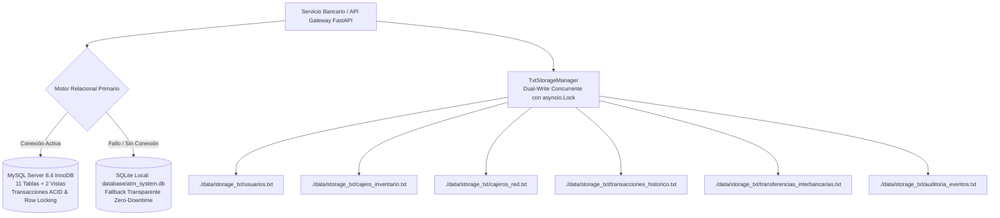
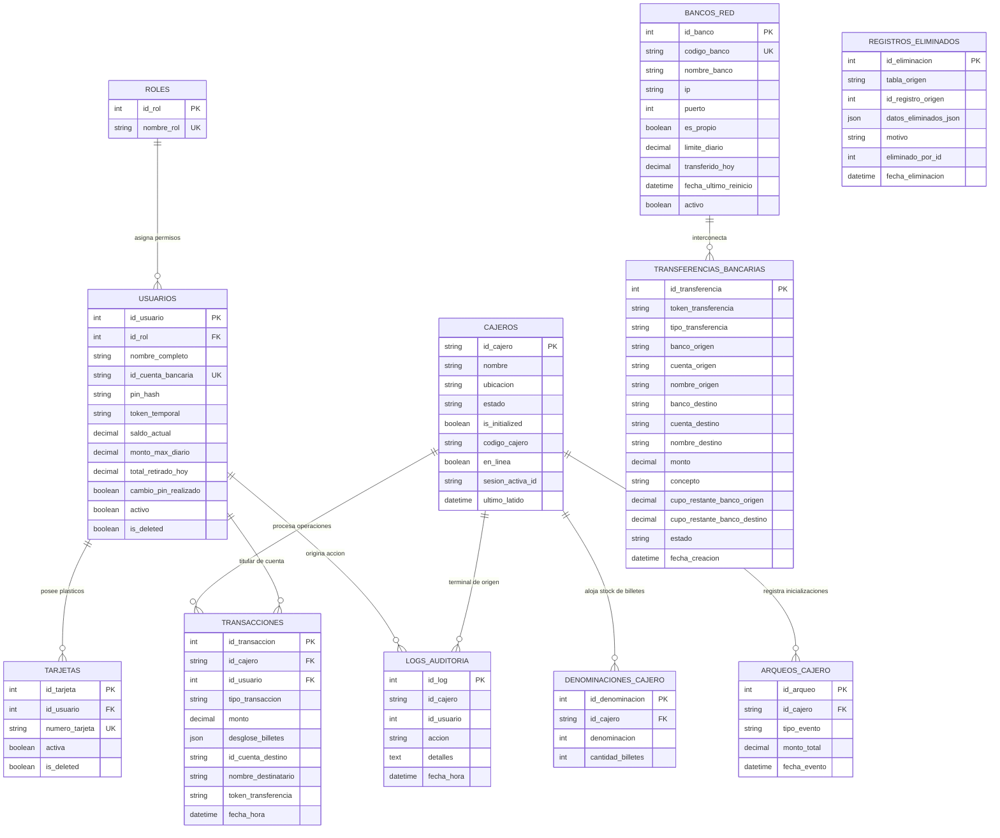

# Arquitectura y Manual de Base de Datos - Sistema de Cajero v2.2.0

## Red Multicajero, Red Interbancaria y Tolerancia a Fallos
### Banco Nacional Inzano GYT (`BANC02`)

Este documento detalla la arquitectura de persistencia de datos, el esquema relacional de 11 tablas y 2 vistas, el mecanismo de tolerancia a fallos por capas (Dual-Engine con Fallback instantáneo a SQLite) y la replicación atómica en archivos planos (`Dual-Write`) del **Sistema de Cajero Automático y Consola Administrativa**.

---

## 1. Visión General de la Arquitectura de Datos

El sistema implementa una arquitectura de persistencia con **alta disponibilidad y tolerancia a fallos por capas**:



### Principios Fundamentales
1. **Motor Primario (MySQL 8.4 InnoDB):** Integridad referencial con restricciones `FOREIGN KEY`, bloqueos pesimistas de fila (`SELECT ... FOR UPDATE`), soporte de JSON nativo y cumplimiento estricto de propiedades ACID.
2. **Fallback Automático (Zero-Downtime):** Si la base de datos MySQL no responde o las credenciales fallan, la capa de acceso a datos [`backend/app/db/database.py`](file:///c:/Users/majop/Documents/Sistema-De-Cajero-main/backend/app/db/database.py) conmuta inmediatamente a SQLite local (`database/atm_system.db`), preservando la continuidad de las operaciones.
3. **Dual-Write Concurrente:** Toda mutación financiera u operativa se escribe en la base de datos relacional y se replica simultáneamente en archivos de texto estructurados mediante `asyncio.Lock()`.
4. **Bóveda Limpia en Primer Inicio (Clean Install Q0.00):** Por directiva de seguridad bancaria, la base de datos limpia arranca con **Q0.00** en todos los cajeros. El autoservicio para clientes queda bloqueado hasta que el Administrador efectúe el arqueo e inicialización inicial.
5. **Aislamiento Multicajero:** El inventario físico de papel moneda se encuentra estrictamente aislado por cajero (`id_cajero`), impidiendo que un retiro en la sucursal `ATM-001` altere el stock físico de `ATM-002`.

---

## 2. Esquema Relacional Completo (11 Tablas y 2 Vistas)

El script maestro DDL se encuentra en [`database/schema.sql`](file:///c:/Users/majop/Documents/Sistema-De-Cajero-main/database/schema.sql).



---

### Detalle de Entidades

#### 1. `roles`
Define los niveles de autorización RBAC del sistema: `ADMINISTRADOR` (1), `USUARIO` (2) y `SUPERADMIN` (3).

#### 2. `usuarios`
Catálogo maestro de clientes corporativos y administradores:
* `id_cuenta_bancaria`: Código numérico único de **8 dígitos** (ej. `10014528` para Carlos Gómez, `20027819` para María López) utilizado para depósitos directos y transferencias entre cuentas.
* `pin_hash`: Hash SHA-256 seguro con salting dinámico (`ATM_SALT_2026:PIN`).
* `saldo_actual`: Saldo contable disponible en Quetzales.
* `monto_max_diario` y `total_retirado_hoy`: Control estricto de cupo diario acumulado.
* `is_deleted`: Bandera de baja lógica (*soft delete*) con respaldo forense.

#### 3. `tarjetas`
Plásticos de débito de 16 posiciones numéricas asociados al titular. Permite reasignación de tarjetas preservando intactos los saldos contables y registros del cliente.

#### 4. `cajeros` (Red Multicajero)
Instancias independientes de terminales de autoservicio:
* `id_cajero`: Clave primaria alfanumérica (`ATM-001`, `ATM-002`, `ATM-003`, etc.).
* `codigo_cajero`: Código numérico confidencial de 4 dígitos para desbloquear el cajero en arranques posteriores.
* `sesion_activa_id`: Identificador de sesión para el candado de concurrencia (impide que dos operadores o ventanas abran simultáneamente el mismo ATM).
* `en_linea` y `ultimo_latido`: Monitoreo en tiempo real para el tablero del Superadministrador.

#### 5. `denominaciones_cajero`
Inventario físico de papel moneda segmentado por terminal:
* Clave foránea `id_cajero` hacia la tabla `cajeros`.
* Restricción de unicidad compuesta `uq_cajero_denom (id_cajero, denominacion)`.
* Denominaciones válidas en Quetzales: **200, 100, 50, 20, 10, 5, 1**.

#### 6. `arqueos_cajero`
Historial de cuadres, inicializaciones y recargas por cajero individual (`INICIALIZACION`, `RECARGA`, `RESET`).

#### 7. `transacciones`
Historial inmutable de operaciones financieras:
* `tipo_transaccion`: `RETIRO`, `DEPOSITO`, `DEPOSITO_A_TERCERO`, `TRANSFERENCIA_INTERBANCARIA`.
* `desglose_billetes`: Objeto JSON con el conteo físico de cada pieza dispensada o recibida (ej. `{"100": 1, "20": 1, "1": 3}`).
* `id_cuenta_destino`, `nombre_destinatario` y `token_transferencia`: Trazabilidad completa de operaciones hacia otras cuentas y otros bancos.

#### 8. `logs_auditoria`
Pista forense que registra acciones críticas (`AUTH_USER`, `VAULT_INIT`, `INTERBANK_TRANSFER`, `A11Y_RECOVERY`), identificando el cajero (`id_cajero`), usuario, fecha y detalles.

#### 9. `registros_eliminados`
Bitácora de seguridad que conserva el snapshot JSON íntegro de registros dados de baja lógica para permitir auditorías judiciales o reactivaciones.

#### 10. `bancos_red` (Protocolo TCP 5000 / UDP 5005)
Directorio dinámico de instituciones bancarias conectadas en red local / VPN:
* `codigo_banco`: Código oficial (`BANC02` para **Banco Nacional Inzano GYT**, `BANC01` para **NEXUSBANK**, `NETGEAR`, etc.).
* `es_propio`: Marca booleana que identifica la instancia bancaria anfitriona.
* `limite_diario` (Q25,000.00) y `transferido_hoy`: Coordinación del cupo diario interbancario acumulado.

#### 11. `transferencias_bancarias`
Conciliación de pagos entre bancos en red:
* `token_transferencia`: Formato estricto `^TRF-\d{8}-\d{6}$` (ej. `TRF-20261031-153022`).
* Registro de banco emisor, cuenta origen, titular origen, banco receptor, cuenta destino, titular destino, monto y estado contable (`APROBADA`, `RECHAZADA`).

---

## 3. Vistas SQL Especializadas

Para facilitar la consulta desde herramientas de gestión como MySQL Workbench, DBeaver o SQL Server Management Studio, se definieron dos vistas relacionales:

### Vista `retiros`
Consolida los débitos de efectivo con el nombre del cliente y el desglose de billetes:
```sql
CREATE OR REPLACE VIEW retiros AS
SELECT 
    t.id_transaccion,
    t.id_cajero,
    t.id_usuario,
    u.nombre_completo AS cliente,
    t.monto,
    t.fecha_hora,
    t.desglose_billetes
FROM transacciones t
JOIN usuarios u ON t.id_usuario = u.id_usuario
WHERE t.tipo_transaccion = 'RETIRO';
```

### Vista `depositos`
Consolida todos los ingresos de efectivo (cuenta propia, depósitos a terceros por cuenta de 8 dígitos y transferencias interbancarias recibidas):
```sql
CREATE OR REPLACE VIEW depositos AS
SELECT 
    t.id_transaccion,
    t.id_cajero,
    t.id_usuario,
    u.nombre_completo AS cliente,
    t.monto,
    t.tipo_transaccion,
    t.id_cuenta_destino,
    t.nombre_destinatario,
    t.token_transferencia,
    t.fecha_hora,
    t.desglose_billetes
FROM transacciones t
JOIN usuarios u ON t.id_usuario = u.id_usuario
WHERE t.tipo_transaccion IN ('DEPOSITO', 'DEPOSITO_A_TERCERO', 'TRANSFERENCIA_INTERBANCARIA');
```

---

## 4. Persistencia Dual Concurrente en Archivos Planos (.txt)

Para cumplir con normativas de respaldo redundante e inspección rápida sin base de datos, cada operación financiera actualiza simultáneamente los archivos ubicados en `./data/storage_txt/`:

1. **`usuarios.txt`:**
   `ID_USUARIO|NOMBRE_COMPLETO|TARJETA_ACTUAL|PIN_HASH|SALDO_ACTUAL|MONTO_MAX_DIARIO|TOTAL_RETIRADO_HOY|CAMBIO_PIN|ULTIMO_ACCESO`
2. **`cajero_inventario.txt`:**
   Línea 1: `TOTAL_BOVEDA|{monto_acumulado}`
   Líneas 2..8: `DENOMINACION|CANTIDAD_BILLETES|SUBTOTAL`
3. **`cajeros_red.txt`:**
   `ID_CAJERO|NOMBRE|UBICACION|ESTADO|INICIALIZADO|CODIGO_CAJERO|EN_LINEA`
4. **`transacciones_historico.txt`:**
   `ID_TX|TIMESTAMP|ID_CAJERO|ID_USUARIO|TIPO|MONTO|DESGLOSE_JSON`
5. **`transferencias_interbancarias.txt`:**
   `ID_TRF|TOKEN|BANCO_ORIGEN|CTA_ORIGEN|BANCO_DESTINO|CTA_DESTINO|MONTO|ESTADO|FECHA`
6. **`auditoria_eventos.txt`:**
   `ID_LOG|TIMESTAMP|ID_CAJERO|ID_USUARIO|ACCION|DETALLES`

El gestor `TxtStorageManager` implementa bloqueos asíncronos (`asyncio.Lock()`) para garantizar concurrencia segura libre de condiciones de carrera.

---

## 5. Instalación y Despliegue de la Base de Datos

### Despliegue Local en MySQL
1. Abrir **MySQL Workbench** o terminal PowerShell.
2. Ejecutar el script:
   ```powershell
   mysql -u root -p < database/schema.sql
   ```
3. El script creará la base de datos `atm_system`, sus 11 tablas, 2 vistas, usuarios de prueba predeterminados (incluyendo al Superadministrador) y las bóvedas de los tres cajeros iniciales vacías a **Q0.00**.

### Despliegue en la Nube / Render
En entornos de producción o contenedores en la nube (Render), el backend ejecuta de forma autónoma el archivo [`backend/app/db/init_db.py`](file:///c:/Users/majop/Documents/Sistema-De-Cajero-main/backend/app/db/init_db.py) al iniciar el servidor FastAPI, creando automáticamente todas las tablas, vistas y registros base si no existen.