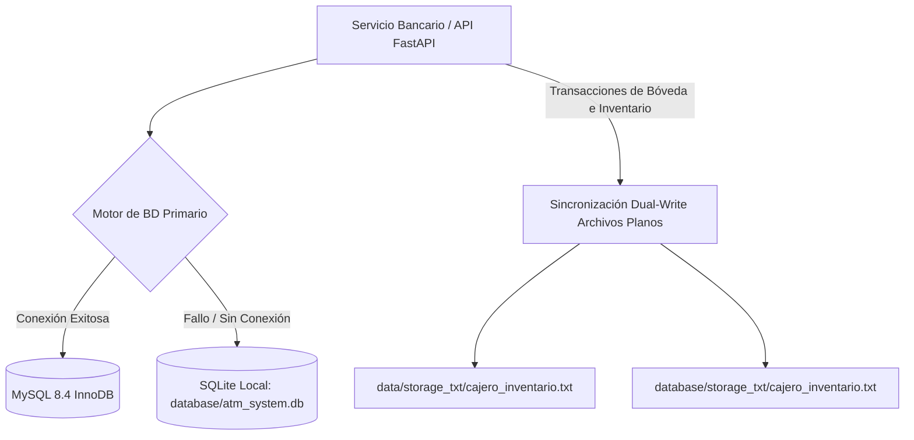
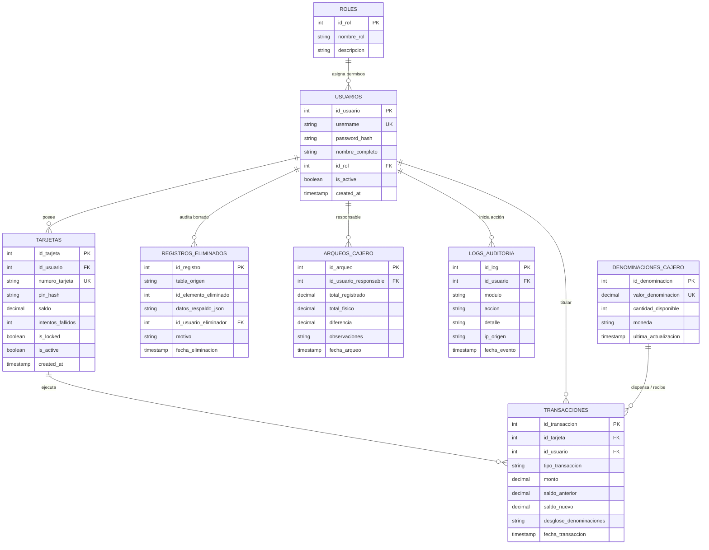

# 🏦 Arquitectura y Manual de Base de Datos - Sistema de Cajero v1.0.2

Este documento detalla la arquitectura de persistencia de datos, el esquema relacional, el mecanismo de tolerancia a fallos (Dual-Engine con Fallback a SQLite) y la sincronización con archivos planos (`Dual-Write`) del **Sistema de Cajero Automático y Consola Administrativa**.

---

## 1. Visión General de la Arquitectura de Datos

El sistema implementa un modelo de datos robusto con **tolerancia a fallos por capas**, garantizando alta disponibilidad, integridad ACID y cumplimiento de pistas de auditoría financiera:



### Principios Fundamentales
1. **Motor Primario:** MySQL 8.4+ utilizando el motor de almacenamiento **InnoDB** para soporte completo de transacciones ACID, bloqueos a nivel de fila (`FOR UPDATE`) y claves foráneas con integridad referencial.
2. **Fallback Automático (Zero-Downtime):** Si MySQL no está levantado o las credenciales no coinciden, [`database/connection.py`](file:///c:/Users/majop/Documents/Sistema-De-Cajero-1.0.2_Release/database/connection.py) conmuta inmediatamente y en tiempo real a SQLite local (`database/atm_system.db`), manteniendo la operatividad sin interrupción del servicio.
3. **Dual-Write Concurrente:** Toda mutación en las denominaciones físicas de la bóveda (retiros, depósitos, arqueos e inicializaciones) se replica atómicamente tanto en la base de datos relacional como en los archivos de texto estructurados (`storage_txt/cajero_inventario.txt`).
4. **Política de Instalación Limpia (Clean Install a Q0.00):** La base de datos inicializada de fábrica o tras un despliegue limpio arranca con **Q0.00** en bóveda. El acceso para clientes queda bloqueado hasta que un Administrador realice la carga inicial y el arqueo mediante la Consola Administrativa.
5. **Auditoría Estricta y Soft Deletes:** Ninguna cuenta o tarjeta se elimina físicamente; se aplica borrado lógico (`is_active = FALSE`) y se registra en `registros_eliminados` y `logs_auditoria`.

---

## 2. Esquema Relacional de Base de Datos (8 Tablas)

El archivo maestro DDL y de migración se encuentra en [`database/schema.sql`](file:///c:/Users/majop/Documents/Sistema-De-Cajero-1.0.2_Release/database/schema.sql). A continuación se describe cada entidad:



### Detalle de Tablas

#### 1. `roles`
Define el nivel de autorización: `Administrador` (acceso a auditoría, bóveda y gestión de usuarios) y `Cliente` (acceso a autoservicio de cajero).

#### 2. `usuarios`
Cuentas de usuario del sistema. Las contraseñas se almacenan cifradas con algoritmos de hashing seguro (PBKDF2/Argon2). Soporta banderas de activación (`is_active`) para bajas lógicas.

#### 3. `tarjetas`
Tarjetas de débito/crédito asignadas a usuarios:
- `numero_tarjeta`: Identificador único de tarjeta (ej. 16 dígitos o formato estandarizado).
- `pin_hash`: Hash seguro del PIN numérico de 4 dígitos.
- `saldo`: Saldo contable disponible del usuario en Quetzales (Q).
- `intentos_fallidos`: Contador incremental de intentos fallidos de PIN.
- `is_locked`: Booleano que bloquea la tarjeta tras superar el umbral de seguridad (3 intentos).
- `is_active`: Flag de baja lógica.

#### 4. `denominaciones_cajero`
Inventario físico de billetes en la bóveda del cajero:
- Denominaciones soportadas: **Q1.00, Q5.00, Q10.00, Q20.00, Q50.00, Q100.00, Q200.00**.
- En instalación limpia, todas las filas tienen `cantidad_disponible = 0`.
- El total en bóveda es la sumatoria de `(valor_denominacion * cantidad_disponible)`.

#### 5. `arqueos_cajero`
Historial de cuadres de caja y auditorías físicas de efectivo:
- Registra `total_registrado`, `total_fisico`, `diferencia` (faltantes/sobrantes), observaciones y usuario responsable.

#### 6. `transacciones`
Historial financiero inmutable de operaciones bancarias:
- Tipos: `RETIRO`, `DEPOSITO`, `CAMBIO_PIN`, `CONSULTA_SALDO`, `BLOQUEO_SEGURIDAD`.
- Contiene los saldos anterior y nuevo para reconciliación contable.
- `desglose_denominaciones`: Almacena el detalle JSON con las cantidades exactas de billetes dispensados o recibidos (ej. `{"100": 5, "50": 2}`).

#### 7. `logs_auditoria`
Pista de auditoría de seguridad del sistema:
- Monitorea eventos como `LOGIN_FAIL`, `AUTH_USER`, `AUTH_ADMIN`, `LOCKOUT`, `BAJA_USUARIO`, `VAULT_INIT`, `VAULT_ARQUEO`, `RETIRO_COMPLETADO`, `DEPOSITO_COMPLETADO`.
- Registra usuario, módulo, detalle, IP y timestamp exacto.

#### 8. `registros_eliminados`
Registro forense de bajas lógicas:
- Almacena en `datos_respaldo_json` el estado completo del registro antes de ser desactivado, garantizando trazabilidad y posibilidad de auditoría o reversión.

---

## 3. Instalación, Carga y Despliegue en MySQL

### Método A: MySQL Workbench (Interfaz Gráfica)
1. Abrir **MySQL Workbench** y conectarse a la instancia local (`127.0.0.1:3306`).
2. Ir a **File > Open SQL Script...** y seleccionar:
   ```
   database/schema.sql
   ```
3. Ejecutar el script haciendo clic en el icono del **Rayo (⚡)**.
4. El script creará la base de datos `atm_system`, sus 8 tablas, los usuarios bancarios predeterminados y las 7 denominaciones en 0.

### Método B: Script por Lote Windows (`.bat`)
Hacer doble clic en el archivo:
```
database/ejecutar_en_mysql.bat
```
El script solicitará la contraseña de `root` de MySQL y aplicará automáticamente el esquema.

### Método C: Línea de Comandos MySQL CLI
```powershell
mysql -u root -p < database/schema.sql
```

---

## 4. Configuración del Archivo `.env`

El backend lee las variables de entorno desde el archivo raíz [`.env`](file:///c:/Users/majop/Documents/Sistema-De-Cajero-1.0.2_Release/.env):

```ini
# Configuración del Servidor FastAPI
API_HOST=0.0.0.0
API_PORT=8000
SECRET_KEY=supersecretkey-cajero-atm-2026-production

# Conexión MySQL Primaria
MYSQL_HOST=127.0.0.1
MYSQL_PORT=3306
MYSQL_USER=root
MYSQL_PASSWORD=tu_password_aqui
MYSQL_DATABASE=atm_system

# Fallback SQLite
SQLITE_DB_PATH=database/atm_system.db
```

> [!NOTE]
> Si `MYSQL_PASSWORD` no coincide o MySQL está apagado, el sistema arranca automáticamente usando `SQLITE_DB_PATH` sin lanzar errores fatales.

---

## 5. Política de Bóveda en Cero (Q0.00) y Bloqueo de Autoservicio

1. **Estado Inicial:** Tras crear la base de datos con `schema.sql` o [`init_db.py`](file:///c:/Users/majop/Documents/Sistema-De-Cajero-1.0.2_Release/database/init_db.py), la suma total de efectivo en bóveda es exactamente **Q0.00**.
2. **Bloqueo para Clientes:** Si un usuario intenta autenticarse en la pantalla de bienvenida con su tarjeta y PIN:
   - El endpoint `/auth/token-preview` y `/auth/atm-status` informan que `vault_empty: true` y `vault_total: 0.0`.
   - La pantalla muestra un banner de advertencia informando que el cajero requiere carga inicial.
   - El servicio bancario rechaza cualquier intento de login regular con código HTTP `403 Forbidden` (`Cajero fuera de servicio: La bóveda se encuentra en Q0.00`).
3. **Desbloqueo Administrativo:**
   - El administrador inicia sesión en modo Admin (`admin` / `admin123`).
   - Ingresa al panel **Inicialización de Bóveda** en la Consola Administrativa.
   - Especifica las piezas para cada denominación (ej. 10 de cada una = Q3,860.00) y pulsa **Inicializar Bóveda**.
   - El sistema actualiza `denominaciones_cajero`, los archivos de texto planos y registra el arqueo inicial.
   - A partir de este momento, el cajero queda 100% operativo para retiros y depósitos de clientes.

---

## 6. Dual-Write y Persistencia en Archivos Planos

Para cumplir con redundancia operativa física, el inventario de la bóveda se almacena simultáneamente en:
- `data/storage_txt/cajero_inventario.txt`
- `database/storage_txt/cajero_inventario.txt`

Formato de archivo plano:
```
DENOMINACION|CANTIDAD|SUBTOTAL
1.00|0|0.00
5.00|0|0.00
10.00|0|0.00
20.00|0|0.00
50.00|0|0.00
100.00|0|0.00
200.00|0|0.00
TOTAL_BOVEDA|0.00
```
Cualquier retiro o depósito procesado en `banking_service.py` ejecuta atómicamente la actualización en MySQL/SQLite y sobrescribe de forma segura estos archivos.
